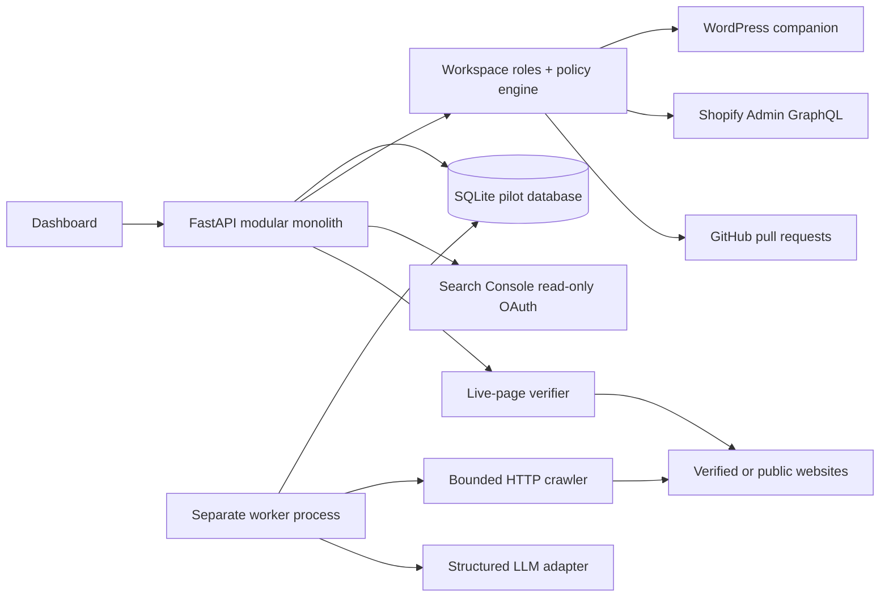

# Agentic SEO V1 architecture and release map

This design implements the uploaded V1 requirements as a controlled pilot codebase. The PRD's five acceptance scenarios are the release gate; a passing simulated test is not a substitute for live integration validation.

## System shape

The API and worker are separate processes. The worker claims bounded crawl jobs, schedules repeat audits, drafts up to three AI metadata plans after a crawl when a key is configured, and automatically executes only WordPress metadata proposals allowed by an explicit site policy. Shopify writes remain human-approved because the current API path lacks an atomic revision precondition. AI modules have no write tools. WordPress and Shopify writes and GitHub pull requests pass through deterministic policy and current-value checks.

SQLite makes this runnable as a single-instance pilot. PostgreSQL, Redis/Celery or a managed queue, object storage, managed secrets, OIDC, and observability are the production target from the PRD; they have not been substituted in silently. `compose.yaml` runs the API and worker on a shared persistent volume for local or isolated staging use.

## Workflow and state

1. A user registers, creates a workspace, invites a member, and adds a public HTTPS site. Site data is scoped by workspace membership.
2. Public auditing is read-only. Ownership is verified by a hosted token or editable WordPress companion credentials. Shopify and GitHub connections require a verified site.
3. The crawler uses a public-address-pinning resolver, HTTPS, no redirects, robots rules, same-host limits, sitemap discovery, 20 pages, 1 MB per page, and a daily crawl budget. It records page snapshots and evidence-backed findings. The health score is a local rule score, not a Google metric.
4. The strategy adapter can produce schema-validated metadata advice and copilot answers, with a token ledger and a daily cap. Crawled text is untrusted context; the model receives no execution tools.
5. Change sets store the exact before and after values. In Assist mode a user approves a specific proposal. In Autopilot mode, a workspace owner must separately enable a field allowlist and daily write cap. The worker records the policy approval for each selected WordPress change; Shopify and GitHub retain human approval.
6. WordPress and Shopify re-read live metadata before applying. WordPress also checks a revision hash. GitHub changes create a PR against a single HTML file; PR creation is not deployment.
7. Verification fetches the live page and compares the rendered field. A merged GitHub PR stays unverified until that comparison passes. WordPress and Shopify restore the captured value only while the live value still matches the applied value.
8. Search Console rows are read through OAuth, stored per site, and displayed as directional trends. They are never represented as proof that a specific change caused traffic movement.

## Data boundaries

`users`, `sessions`, `workspaces`, `memberships`, and `invitations` define access. `sites` and `integrations` hold site identity and encrypted connector credentials. `crawl_jobs`, `crawls`, `pages`, `page_snapshots`, and `findings` keep scan provenance. `agent_runs`, `action_plans`, `content_drafts`, and `usage_ledger` separate AI drafts from writes. `changes`, `change_sets`, `policy_approvals`, `write_policies`, and `events` keep execution and authorization evidence. `search_metrics` and `reports` support directional analytics and client reports.

All user-facing site reads and writes check workspace membership. Owner-only policy and invite operations are narrower. Session and CSRF tokens are stored as hashes; WordPress, Shopify, GitHub, and Google refresh credentials are encrypted using a persistent Fernet key. Production must use HTTPS cookies and a managed secret store.

## PRD coverage

| Area | Current code | Release work still needed |
| --- | --- | --- |
| Authentication and agency | Registration, password sessions, owner/editor/viewer membership, invitations, client workspaces and reports | OIDC, invite delivery and account recovery; export and live-data deletion are implemented but backup retention is operator-controlled |
| Website onboarding | Ownership token, WordPress companion, Shopify and GitHub connection health, GSC OAuth | Live credential and permission validation on staging systems |
| Audit | Page inventory, sitemap/robots, metadata, HTTP, noindex, canonical, headings, images, JSON-LD parse signals, mobile viewport signal, link depth, orphan candidates, rule score | Selective rendering, PageSpeed/Core Web Vitals, robust schema validation and broader crawl scale |
| AI intelligence and copilot | Structured provider adapter, grounded metadata drafts, tool-free copilot, persisted agent runs, token cap | Provider credentials, evaluation set, prompt-injection tests, better prioritization |
| Execution | Exact proposals, Assist approvals, bounded Autopilot metadata policy, WordPress and Shopify edits, GitHub PRs, live verification, WordPress/Shopify guarded restore | Live integration tests, interrupted-write recovery for all connectors, approved link/schema edits |
| Automation | Separate worker, scheduled crawls, signed site-change webhook, retries, automatic plan drafts, policy-bounded WordPress metadata execution | A production-grade queue and vendor-specific webhook wiring |
| Analytics and keywords | GSC OAuth code, 28-day sync, query opportunities, trends and change history | Live Google consent/property validation and regression alerts |
| Content | AI briefs and drafts, editorial approval, no publication | Editorial editing and controlled CMS publishing, if later authorized |
| Commercial | Usage ledger, daily AI cap, pilot billing screen | Subscriptions, actual credits and payment integration |
| AI-search visibility | No visibility claims | Technical readiness heuristic is implemented; visibility sampling and evaluation protocol remain |
| Operations | Container files, health endpoint, login throttling, and a tested SQLite backup/restore copy | PostgreSQL, monitoring, off-host backup drill, broader abuse controls, security review, staging deployment |

## Five release acceptance scenarios

| Scenario | Current evidence | Gate remaining |
| --- | --- | --- |
| WordPress end-to-end | Automated simulated audit → proposal → approval → apply → live verification → restore passes | Repeat on staging WordPress with real theme/cache behavior and PHP lint |
| Shopify end-to-end | Simulated connection → exact approval → apply → verify → restore passes | Confirm GraphQL API contract and permissions on a development store |
| GitHub PR/deployment | Simulated PR remains unverified until merge and live match | Create real PR in a disposable test repository, merge/deploy, then verify |
| AI security | Tool-free AI adapter, tenant isolation, explicit write policy, approval tests | Red-team crawled-page prompt injection, broader abuse controls and security review |
| Agency | Multiple workspaces, invitations, members and generated site reports | Multi-user staging run and branded report review |

**Release status: not ready for customer production.** No live vendor account, LLM provider, or Google property was connected in this build session. The current container environment has no deployment target or runtime secrets configured. The five scenarios must pass with real systems before the PRD's controlled-pilot gate can be met.
